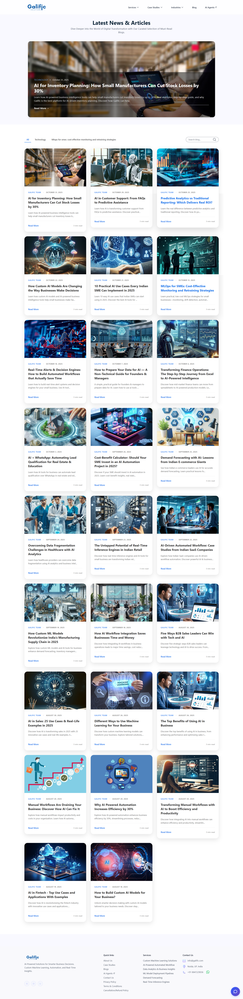
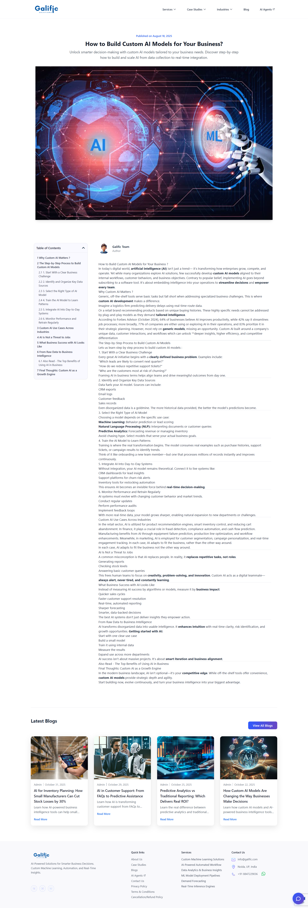

# Futurise Blog — Frontend Implementation Prompt

# use the current theme and color to build the ui
## blog page ui refrence


## blog detail page ui refrence 

## API Base URL
```
http://localhost:5000/api   put in config js file 
```

### Blog API Endpoints
| Method | Endpoint | Description |
|--------|----------|-------------|
| GET | `/api/blogs` | All published blogs (newest first) |
| GET | `/api/blogs/admin/all` | All blogs including drafts (admin only) |
| GET | `/api/blogs/:slug` | Single blog by slug |
| POST | `/api/blogs` | Create blog |
| PUT | `/api/blogs/:id` | Update blog by MongoDB `_id` |
| DELETE | `/api/blogs/:id` | Delete blog by MongoDB `_id` |
| POST | `/api/upload` | Upload image → returns `{ imageUrl, filename }` |

### Blog Document Shape
```json
{
  "_id": "...",
  "title": "...",
  "slug": "top-ai-trends-2025",
  "shortDescription": "...",
  "featuredImage": "/uploads/blogs/filename.webp",
  "category": "AI",
  "tags": ["AI", "tech"],
  "meta": {
    "metaTitle": "...",
    "metaDescription": "...",
    "metaKeywords": ["AI", "tech"],
    "ogType": "article",
    "robots": "index,follow"
  },
  "content": "# Markdown content here...",
  "status": "draft | published",
  "createdAt": "...",
  "updatedAt": "..."
}
```

---

## 1. Navbar — Add Blog Link

In `src/Layout/Navbar.jsx`, add `{ label: "Blog", path: "/blog" }` to the `NAV_ITEMS` array between "Portfolio" and "Contact":

```js
const NAV_ITEMS = [
  { label: "Home", path: "/" },
  { label: "About", path: "/about" },
  { label: "Services", path: null, isServices: true },
  { label: "Portfolio", path: "/portfolio" },
  { label: "Blog", path: "/blog" },       // ← add this
  { label: "Contact", path: "/contact" },
];
```

Also add it to `navbarOptions` constant (used for mobile drawer) so it appears in the mobile menu as well.

---

## 2. Routes — Add Blog Routes

In `src/Routes/AllRoutes.jsx`, lazy-load and add three new routes:

```jsx
const BlogsPage      = lazy(() => import("../Pages/BlogsPage"));
const BlogDetailPage = lazy(() => import("../Pages/BlogDetailPage"));
const AdminBlogPage  = lazy(() => import("../Pages/AdminBlogPage"));

// Inside <Routes>:
<Route path="/blog"              element={<BlogsPage />} />
<Route path="/blog/:slug"        element={<BlogDetailPage />} />
<Route path="/futurise-admin/blog" element={<AdminBlogPage />} />
```

---

## 3. Homepage — Latest 4 Blogs Section

**Location:** In `src/Pages/HomePage.jsx`, add a `<LatestBlogs />` section **just above** the `<Footer />` (i.e., as the last section inside the page, before the footer renders).

### Component: `src/Components/blog/LatestBlogs.jsx`

**Layout & Behavior:**
- Section heading: `"Latest from the Blog"` — styled like other homepage section headings (gradient text on accent word)
- Top-right corner: a ghost/link-style button `"View all articles →"` that navigates to `/blog` — use `variant="outlineGlow"` or a plain `Link` with `accent.solid` color and arrow icon (`FiArrowUpRight`)
- Fetch `/api/blogs` on mount, take first 4 results
- Display as a `SimpleGrid` with `columns={{ base: 1, md: 2, lg: 4 }}` and `spacing={6}`

**Blog Card Design (glass card):**
```
- borderRadius="20px"
- border="1px solid" borderColor="border.subtle"
- bg="bg.surface"
- overflow="hidden"
- backdropFilter="blur(12px)"
- transition="all .3s cubic-bezier(0.22,1,0.36,1)"
- _hover:
    transform="translateY(-6px)"
    borderColor="rgba(180,160,255,0.4)"
    boxShadow="0 24px 60px -20px rgba(123,108,255,0.35)"
```

**Card Content:**
1. **Image** — `featuredImage` as full-width top image, `h="180px"`, `objectFit="cover"`, with a subtle gradient overlay at bottom `linear(to-t, rgba(8,8,13,0.7), transparent)`
2. **Category badge** — small pill badge (`brand.500` bg, white text, `borderRadius="full"`, `fontSize="xs"`) positioned absolute top-left over image
3. **Body padding** `p={5}`:
   - `title` — `fontSize="md"` `fontWeight={700}` `color="text.primary"` `noOfLines={2}`
   - `shortDescription` — `fontSize="sm"` `color="text.muted"` `noOfLines={2}` `mt={2}`
   - Bottom row `mt={4}`: date (formatted `createdAt`) on left in `text.faint`, and `"Read more →"` link in `accent.solid` on right
4. Entire card is wrapped in `<Link to={/blog/${slug}}>` (React Router)

**Entry Animation:**
Use Framer Motion `variants` with `staggerChildren` so cards animate in one by one:
```js
container: { hidden: {}, visible: { transition: { staggerChildren: 0.1 } } }
card:       { hidden: { opacity: 0, y: 30 }, visible: { opacity: 1, y: 0, transition: { duration: 0.5, ease: [0.22,1,0.36,1] } } }
```
Use `whileInView` so animation triggers when section scrolls into view (`viewport={{ once: true, margin: "-80px" }}`).

**Loading State:** Show 4 skeleton cards (use Chakra `Skeleton` with `borderRadius="20px"` and same height as cards).

---

## 4. All Blogs Page — `/blog`

### File: `src/Pages/BlogsPage.jsx`

**Page Meta:** Set `<title>Blog | Futurise Solutions</title>` using `react-helmet-async` or `document.title` in `useEffect`.

### 4A. Hero Section (Latest Blog)

Fetch `/api/blogs`, use `blogs[0]` as the hero.

**Layout:**
- Full-width section, `minH="520px"`, relative position
- Background: `featuredImage` as `<Image>` covering the full section with `objectFit="cover"`, with a dark overlay gradient `linear(to-r, rgba(8,8,13,0.92) 0%, rgba(8,8,13,0.65) 60%, rgba(8,8,13,0.2) 100%)`
- Content positioned on left side: `maxW="600px"` inside `maxW="1200px"` container

**Hero Content (left side):**
- Category badge (same pill style as card)
- `LATEST POST` label — `fontSize="xs"` `letterSpacing="0.15em"` `textTransform="uppercase"` `color="accent.solid"`
- `title` — Large heading `fontSize={{ base: "3xl", md: "5xl" }}` `fontWeight={800}` `color="text.primary"` `lineHeight={1.1}` `noOfLines={3}`
- `shortDescription` — `color="text.muted"` `fontSize="lg"` `noOfLines={3}` `mt={4}`
- Date + read time estimate (`Math.ceil(wordCount / 200)` min read)
- CTA Button: `variant="gradient"` `"Read Article"` with `FiArrowRight` icon → links to `/blog/${slug}`

**Animation:** Hero content slides in from left (`x: -40 → 0`) on mount.

### 4B. Category Filter Bar

Below the hero, a sticky filter bar:
- `position="sticky"` `top="74px"` (below navbar) `zIndex={10}` `bg="rgba(8,8,13,0.85)"` `backdropFilter="blur(16px)"` `borderBottom="1px solid" borderColor="border.subtle"`
- Extract unique categories from all fetched blogs
- Show `"All"` + each category as pill buttons
- Active pill: `bgGradient={GRADIENT}` `color="white"` `boxShadow="0 4px 20px -8px rgba(123,108,255,0.6)"`
- Inactive pill: `variant="outlineGlow"` `color="text.muted"`
- Smooth `transition="all .2s"` between active states

### 4C. Blog Grid (All Blogs)

Below the filter bar, show all blogs (excluding `blogs[0]` which is already in hero) filtered by selected category.

**Grid:** `SimpleGrid columns={{ base: 1, md: 2, lg: 3 }} spacing={6}` inside `maxW="1200px" mx="auto" px={{ base: 5, md: 8 }} py={16}`

Use the same **glass card** design from the LatestBlogs section (Section 3).

**Effects:**
- **Stagger animation on load:** cards animate in with `staggerChildren: 0.07` using `whileInView`
- **Filter transition:** When switching categories, animate out old cards (`AnimatePresence` with `mode="wait"`) and stagger in new ones
- **Hover glow:** purple glow `boxShadow` on hover as defined in card style above
- **Empty state:** If no blogs in category, show centered message: `"No articles in this category yet."` with a subtle ghost icon

---

## 5. Blog Detail Page — `/blog/:slug`

### File: `src/Pages/BlogDetailPage.jsx`

**Data fetch:** `GET /api/blogs/:slug` where `slug = useParams().slug`

### 5A. Meta Tags (SEO)

Use `react-helmet-async`. Install: `npm install react-helmet-async`.

Wrap `App.jsx` root with `<HelmetProvider>`.

In `BlogDetailPage`, set all meta tags from the `meta` object:

```jsx
<Helmet>
  <title>{blog.meta?.metaTitle || blog.title} | Futurise Solutions</title>
  <meta name="description"   content={blog.meta?.metaDescription || blog.shortDescription} />
  <meta name="keywords"      content={blog.meta?.metaKeywords?.join(", ") || blog.tags?.join(", ")} />
  <meta name="robots"        content={blog.meta?.robots || "index,follow"} />
  <meta name="author"        content="Futurise Solutions" />

  {/* Open Graph */}
  <meta property="og:type"        content={blog.meta?.ogType || "article"} />
  <meta property="og:title"       content={blog.meta?.metaTitle || blog.title} />
  <meta property="og:description" content={blog.meta?.metaDescription || blog.shortDescription} />
  <meta property="og:image"       content={`http://localhost:5000${blog.featuredImage}`} />
  <meta property="og:url"         content={window.location.href} />

  {/* Twitter Card */}
  <meta name="twitter:card"        content="summary_large_image" />
  <meta name="twitter:title"       content={blog.meta?.metaTitle || blog.title} />
  <meta name="twitter:description" content={blog.meta?.metaDescription || blog.shortDescription} />
  <meta name="twitter:image"       content={`http://localhost:5000${blog.featuredImage}`} />
</Helmet>
```

### 5B. Page Layout

**Hero:**
- Full-width `featuredImage`, `maxH="480px"`, `objectFit="cover"` with bottom gradient overlay
- Over the image: category badge + `LATEST POST` label (if it is the latest)
- Below image: title in large heading, date + read time + author "Futurise Solutions", tags as small pills

**Content Area:**
- `maxW="800px"` `mx="auto"` `px={{ base: 5, md: 8 }}` `py={12}`
- Content is stored as **Markdown** — render using `react-markdown` with `remark-gfm`
- Install: `npm install react-markdown remark-gfm`

**Markdown Styling (custom components prop):**
Style all markdown elements to match the theme:
```jsx
components={{
  h1: ({ children }) => <Heading as="h1" fontSize="3xl" mt={10} mb={4} color="text.primary">{children}</Heading>,
  h2: ({ children }) => <Heading as="h2" fontSize="2xl" mt={8} mb={3} color="text.primary">{children}</Heading>,
  h3: ({ children }) => <Heading as="h3" fontSize="xl" mt={6} mb={2} color="text.primary">{children}</Heading>,
  p:  ({ children }) => <Text fontSize="lg" lineHeight={1.9} color="text.muted" mb={5}>{children}</Text>,
  a:  ({ href, children }) => <Link href={href} color="accent.solid" _hover={{ color: "text.primary" }} isExternal>{children}</Link>,
  ul: ({ children }) => <Box as="ul" pl={6} mb={5} color="text.muted" fontSize="lg">{children}</Box>,
  ol: ({ children }) => <Box as="ol" pl={6} mb={5} color="text.muted" fontSize="lg">{children}</Box>,
  li: ({ children }) => <Box as="li" mb={2} lineHeight={1.8}>{children}</Box>,
  blockquote: ({ children }) => (
    <Box borderLeft="3px solid" borderColor="brand.500" pl={5} py={2} my={6}
         bg="rgba(123,108,255,0.08)" borderRadius="0 12px 12px 0" color="text.muted" fontStyle="italic">
      {children}
    </Box>
  ),
  code: ({ inline, children }) => inline
    ? <Box as="code" px={2} py={0.5} borderRadius="6px" bg="rgba(255,255,255,0.07)" color="accent.solid" fontSize="0.9em">{children}</Box>
    : <Box as="pre" p={5} borderRadius="14px" bg="navy.700" border="1px solid" borderColor="border.subtle" overflowX="auto" mb={6} fontSize="sm"><code>{children}</code></Box>,
  img: ({ src, alt }) => <Image src={src} alt={alt} borderRadius="14px" my={6} w="full" objectFit="cover" />,
  hr: () => <Box borderTop="1px solid" borderColor="border.subtle" my={8} />,
}}
```

**Side Panel (desktop only, `display={{ base: "none", lg: "block" }}`):**
Sticky sidebar `position="sticky" top="100px"`:
- Table of contents (parse `##` headings from markdown)
- Tags list
- "Share this article" buttons (copy link, LinkedIn, Twitter/X)

**Back Navigation:**
Top of page: `← Back to Blog` link using `FiArrowLeft` → navigates to `/blog`

**Related Posts:**
Below content: Show 3 blogs from the same category (exclude current) as small horizontal cards.

---

## 6. Admin Blog Dashboard — `/futurise-admin/blog`

### File: `src/Pages/AdminBlogPage.jsx`

This route is **not linked anywhere** in the navbar or footer. Admin accesses it by typing the URL directly.

### 6A. Password Gate

On first visit (or if not authenticated), show a centered login card:

```
- bg="navy.800" borderRadius="24px" border="1px solid" borderColor="border.subtle"
- boxShadow="0 40px 80px -24px rgba(0,0,0,0.7)"
- maxW="420px" mx="auto" mt="15vh" p={10}
```

**Fields:**
- Password input (single field — no username needed)
- `variant="gradient"` submit button `"Enter Dashboard"`
- On submit: compare against hardcoded env variable `import.meta.env.VITE_ADMIN_PASSWORD`
- On success: set `isAuthenticated = true` in `useState` (session only — no localStorage for security)
- On fail: show red toast `"Incorrect password"`

Add to `.env`:
```
VITE_ADMIN_PASSWORD=your_secure_password_here
```

### 6B. Admin Dashboard Layout

Two-panel layout (after authentication):

**Left sidebar `w="260px"` (desktop) / full top bar (mobile):**
- Futurise logo
- `"All Blogs"` count badge
- `"+ New Blog"` gradient button → opens create modal/drawer
- Status filters: All / Published / Draft

**Main area:**
- Search bar at top to filter blogs by title
- Blog list table or card list

### 6C. Blog List Table

Each row shows:
- `featuredImage` thumbnail (`w="60px" h="40px" borderRadius="8px" objectFit="cover"`)
- `title` (truncated at 50 chars)
- `category`
- `status` badge — `"published"` → green pill, `"draft"` → yellow/amber pill
- `createdAt` date
- Actions: `View` (eye icon → `/blog/:slug`), `Edit` (pencil icon), `Delete` (trash icon with confirm dialog)

**Delete confirmation:** Use Chakra `AlertDialog` — `"Are you sure you want to delete this blog? This action cannot be undone."`

### 6D. Create / Edit Blog — Drawer or Full Page

Use a `Drawer` (size="full") or navigate to a separate `/futurise-admin/blog/new` and `/futurise-admin/blog/edit/:id` route.

**Form Fields:**

| Field | Input Type |
|-------|-----------|
| Title | `Input` — auto-generates slug preview below it |
| Short Description | `Textarea` (2-3 lines) |
| Category | `Select` or `Input` |
| Tags | Tag input — type tag + Enter to add, click × to remove |
| Featured Image | Upload button → `POST /api/upload` → stores returned URL |
| Status | `RadioGroup` — Draft / Published |
| **Meta Section** (collapsible `Accordion`) | |
| Meta Title | `Input` with character counter (max 60) |
| Meta Description | `Textarea` with character counter (max 160) |
| Meta Keywords | Same tag-input as Tags |
| OG Type | `Select` — default "article" |
| Robots | `Select` — default "index,follow" |
| **Content** | **Markdown Editor** (see below) |

**Markdown Editor:**
Use `@uiw/react-md-editor` — it renders a split-pane markdown editor with preview built in.

Install: `npm install @uiw/react-md-editor`or cke editor use best

```jsx
import MDEditor from "@uiw/react-md-editor";

<MDEditor
  value={content}
  onChange={setContent}
  height={500}
  data-color-mode="dark"
/>
```

This gives a GitHub-flavored markdown editor with toolbar (bold, italic, headings, code blocks, image insert, preview toggle) — no custom CKEditor config needed.

**Image Insert in Editor:**
Add a custom toolbar button that opens a file picker → uploads to `/api/upload` → inserts `` at cursor position.

**Submit:**
- Create: `POST /api/blogs` with full form body
- Edit: `PUT /api/blogs/:id` with full form body (always send full `meta` object to avoid partial overwrite)
- On success: show green toast, refresh blog list

---

## 7. File Structure to Create

```
src/
├── Pages/
│   ├── BlogsPage.jsx          ← All blogs page (/blog)
│   ├── BlogDetailPage.jsx     ← Single blog (/blog/:slug)
│   └── AdminBlogPage.jsx      ← Admin dashboard (/futurise-admin/blog)
├── Components/
│   └── blog/
│       ├── LatestBlogs.jsx    ← Homepage section (latest 4 blogs)
│       ├── BlogCard.jsx       ← Reusable card used in LatestBlogs + BlogsPage
│       ├── CategoryFilter.jsx ← Filter pill bar
│       └── BlogMarkdown.jsx   ← react-markdown with theme components
└── hooks/
    └── useBlogs.js            ← Custom hook: fetch + cache blog data
```

---

## 8. Packages to Install

```bash
npm install react-markdown remark-gfm react-helmet-async @uiw/react-md-editor
```

---

## 9. Key Implementation Notes

- All user-facing pages (BlogsPage, BlogDetailPage) use **Framer Motion** for entry animations — consistent with existing pages
- Use `whileInView` + `viewport={{ once: true }}` for scroll-triggered animations — never animate on every scroll
- Images from the API: prepend `http://localhost:5000` to `featuredImage` (e.g., `http://localhost:5000/uploads/blogs/filename.webp`)
- Admin page has **no navbar/footer** — wrap it in a conditional check in `App.jsx` or use a separate layout
- The `slug` is auto-generated by the backend from `title` — show a preview `"/blog/top-ai-trends-2025"` below the title field in the admin form
- Format dates using `new Date(createdAt).toLocaleDateString("en-US", { year: "numeric", month: "long", day: "numeric" })`
- Read time: `Math.ceil(content.split(" ").length / 200)` minutes
